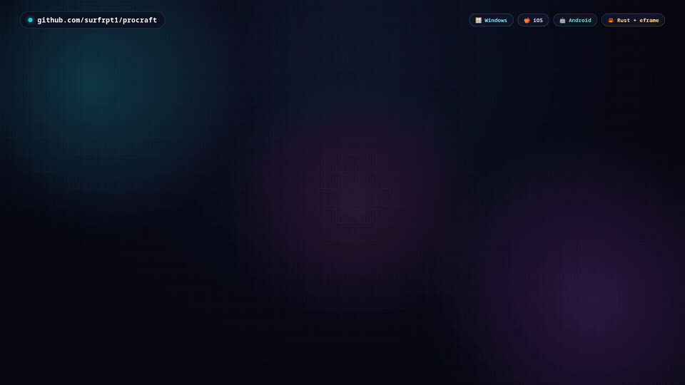

# ProCraft

<p align="center">
  <a href="assets/procraft-promo.mp4">
    
  </a>
</p>

By [surfrpt1](https://github.com/surfrpt1).

An open-source, clean-room raster painting studio in pure Rust: layered
painting, a soft-round brush engine, and PNG import/export. Inspired by
professional painting workflows; every line of code and every asset here is
original.

> **Trademark note:** "Procreate" is a registered trademark of Savage
> Interactive. ProCraft is an independent project with its own name, branding
> and code, and is not affiliated with or endorsed by any other vendor.

## Get ProCraft

Signed builds for all three targets on the [releases page](https://github.com/surfrpt1/procraft/releases/latest):

| Platform | File | Install |
|---|---|---|
| Windows 10/11 (x64) | `procraft-vX.Y.Z-windows-x64.zip` | Unzip, run `procraft.exe` |
| iPhone / iPad (iOS 17+) | `ProCraft-ios-vX.Y.Z.ipa` | Sideload (Sideloadly / AltStore; free accounts re-sign weekly) |
| Android 10+ (ARM64 + x86_64) | `ProCraft-android-vX.Y.Z.apk` | Allow unknown apps once, tap to install |

Android files live in the app's external folder
(`Android/data/com.surfrpt1.procraft/files`, reachable over USB): the
in-app Import browser reads it, and saves land there, then appear in
Photos after a media scan.

## Status: milestone 50

- [x] Layered document model (add / hide / reorder / opacity / blend)
- [x] Soft-round brush + eraser with spacing, dynamics and undo
- [x] egui desktop app: paint, layers panel, color/size sliders, PNG export
- [x] Project files (`.procraft` v10 with masks, clipping + 10 blends, layer offsets, mirror center, groups + group opacity, frame holds; v1-v9 still open), pinch-to-zoom, themes, page colors with active-preset highlight
- [x] Rectangular + freehand lasso selections constraining paint
- [x] Flood fill bucket with tolerance (selection-aware, symmetry-mirrored) + ColorDrop threshold-drag (hold + drag sweeps 0-255 with live preview, one undo step)
- [x] Move tool (drag active layer), shape tools (line/rect/ellipse/triangle/diamond/star/arrow/polygon + fill)
- [x] Layer transforms (scale, rotate, flip H/V with bilinear sampling)
- [x] Mirror symmetry painting (horizontal / vertical / both + axis overlay) with movable center (drag on canvas, edge parking, Reset, saved)
- [x] Layer filters: brightness/contrast, box blur, unsharp sharpen (selection-masked) with live snapshot preview (scrub, then Apply keeps; one undo step per gesture)
- [x] Kaleidoscope symmetry (2-16 segments), layer rename/duplicate/merge, eyedropper, honest brush previews
- [x] Non-destructive layers: reveal masks (paint luminance, eraser reveals, mask viewer), clipping masks, 10 blend modes (masks travel with transforms, merge bakes them)
- [x] Layered PSD interchange: export keeps names/opacity/blends/clipping/transparency/masks/groups for Photoshop/Procreate/Krita/GIMP; import restores structure including nested groups (masks, collapse state and exotic blends documented gaps)
- [x] Compressed project files (PCRAFT04 zlib per layer; verified 12MB → 107KB on a 3-layer painting, corrupt payloads rejected)
- [x] Brush library: named custom brushes with honest clickable previews + active highlight, `.pcbrush` set import/export (validated, max 64)
- [x] Pro brush interop: import Photoshop `.abr` (v6-v10 sampled tips + names/spacing via UUID linkage, verified on real Photoshop 2026 files), Procreate `.brush`/`.brushset` (Shape tips), Clip Studio Paint `.sut` (SQLite variant settings + embedded tips), Krita `.kpp`/`.bundle` (verified on Krita repo presets: MaskGenerator diameter, Opacity x Flow, embedded tips), GIMP `.gbr`, tip images; export grayscale tip PNGs for other software
- [x] Shape tools wave 2 (triangle/diamond/star/arrow/3-12-sided polygon, outline + fill), collapsible sidebars + wrapped top bar for portrait/iPad, off-page-stroke crash fix, touch-sized layer rename (Save/Cancel)
- [x] Native iOS build (target-gated eframe/rfd-shim, CI-built IPA sideload, v5 at v0.6.0): document-picker imports, Documents saves + share sheet, async opens, touch-force pressure, post-open repaint fix
- [x] About dialog (app-centered; auto version, builder, repo + check-for-updates links, MIT line)
- [x] Brush dynamics: pressure/velocity size + opacity curves, grain + scale, roundness, angle-follow rotation, scatter, stabilizer smoothing (old `.pcbrush` files load identically)
- [x] Palettes: multi-palette manager (up to 16 named sets, rename/delete, per-palette import/export), `.pcpalette` save/open, GIMP `.gpl` import, starter set, HSL + complementary/triadic/analogous harmonies, full-height 3x8 swatch grids; drawing guides (off/square/iso/1pt/2pt) with canvas overlay + snap (iso-lattice and vanishing-point rays, Snap-range magnet) and draggable vanishing points (canvas handles, edge parking, Reset)
- [x] Animation Assist: layers-as-frames, play/stop + FPS stepping, forward/ping-pong loop + frame hold, onion skins (red/blue ghosts + amount), GIF export (1-60fps, infinite loop) and GIF import back to editable layers (hidden layers skipped in playback and export)
- [x] Text tool: click-to-anchor, multiline 8-128px dialog, bundled Inter (OFL, latin subset, fontdue raster), bakes to layer in one undo step
- [x] Lossless layer moves: O(1) offsets (off-canvas content preserved, undoable), offset-aware paint/flood/text/merge/flip/affine/masks/animation/PSD
- [x] Micro-steppers (−/+ on every slider), compact tools panel
- [x] Drawing Assist: strokes lock to guides while drawing (perspective nearest-ray incl. draggable VPs, square/iso dominant axis; 4px deadzone, parked-on-VP and Off paint free) with checkbox + hint and amber lock-line overlay (brush + eraser)
- [x] Selection Studio: feather/grow-shrink/smooth/invert/select-opaque/outline in a collapsing group, 0-255 weighted masks (graduated coverage through paint/tone/blur/sharpen, flood binary-gated), bbox-retightened rect ants, stamp-path feather fix
- [x] Layer groups: nested model with effective visibility, panel tree (collapse/eye/rename/+Add/Ungroup), per-group opacity in compositing/frames, PSD group round-trip
- [x] Smudge tool (finger pickup, Strength slider), canvas rotate (twist gesture + slider/Reset), two-finger-tap undo / three-finger-tap redo, autosave + crash recovery (silent snapshots, Recover/Discard prompt)
- [x] JPEG export with quality slider + lossless TIFF export; drag-crop rect + pad/trim canvas resize with anchor (offsets carry content)
- [x] Pick tool with magnifier loupe ring (Alt-pick too), palette-from-image and palette-from-canvas import
- [x] Animation frame UI: duplicate frame, per-frame hold (playback + GIF round-trip timing), onion strength per side
- [x] Adaptive top bar: all groups flow inline and fold to 2+ lines on narrow displays (phone portrait, small windows) instead of overlapping
- [x] Native Android build (NativeActivity + wgpu, cargo-apk sideload APK, ARM64 + x86_64 universal, release-signed): touch paint, adaptive bar, in-app Import browser over USB (`Android/data/...`), external saves with media scan
- [x] Gallery/file browser (M33): new/open/recent with thumbnails; Reference companion (M34); Selection upgrades (M35): save/load, nudge/flip; Adjustments (M36/M37): Curves/Levels + HSL/Balance/Recolor
- [x] Typography (M38): TTF/OTF import, leading/tracking/outline; Brush depth (M39); Liquify-lite (M40); Time-lapse snapshots (M41); iPad layout polish (M42)
- [x] Transform depth (M43/M44): corner-pin distort + warp mesh (masks travel); Stability hardening (M45): fuzz open, OOM guards; SAF picker (M46); Palm rejection + Pencil (M47)
- [x] Touch workflow: Hand pan tool (margin-grab fix), Pencil + two-finger pan, shift+wheel horizontal pan, hidden scrollbars, tap undo/redo
- [x] On-canvas transform handles (M48): distort, skew, perspective, free, and warp-mesh handles with live preview, release-apply, Reset / Esc cancel
- [x] Puppet Warp (M48): active-pin ring, Alt/Delete-pin tool, Shift/marquee multi-select, group move, expandable mesh; deleting a pin restores its effect, and undo/layer changes re-arm instead of warping stale pixels
- [x] Settings + keybinds (M49): cross-platform `settings.json` (seed-once from legacy ui.json, corrupt-file quarantine), Shortcuts editor with exact-chord dispatch (Ctrl+Shift+Z fixed), Shift+drag brush size
- [x] Editable text layers (M50): Procreate-style re-editable text (tap to select / re-edit / move), Rasterize bakes to pixels, v11 project format (v1-v10 still open), paint-guard hint on text layers
- [x] Tablet/phone top bar: folded view cluster, touch-sized View ▾ / File ▾ menus, drag-collapse panel sections, iOS safe-area refold, Android status-bar inset
- [x] Input fixes: motionless click/tap paints a dab (brush/eraser/smudge), text opens on drag-start, iPad tap positions read from `interact_pointer_pos` (hover_pos is None on touch-tap frames)
- [x] Polish: Android adaptive launcher icon, region-local animation-assist rasterize (385x faster paint ticks), shape drag preview traces the selected shape, no console window in release builds

## Icon

Original layer-stack mark drawn natively in VectorCraft (headless batch;
`assets/icon-generator.py` replays the whole construction, `assets/icon.svg`
is the editable source). Shipped as the window icon and the embedded exe icon.

## Build

Needs Rust 1.88+ ([rustup](https://rustup.rs)):

```sh
git clone https://github.com/surfrpt1/procraft.git
cd procraft
cargo run --release -p procraft
```

### Mobile

- iOS: `rustup target add aarch64-apple-ios && cargo check -p procraft --target aarch64-apple-ios`
  (test IPAs are cut by the `ios-ipa` CI workflow).
- Android: install the Android NDK, `cargo install cargo-apk`, then
  `cargo apk build -p procraft --lib` (the `android-apk` CI workflow builds,
  signs and uploads test APKs; the `release` profile needs the private
  release keystore, maintainer-only).

## Layout

- `crates/engine` — document, layers, brush dabs, undo, PNG I/O (no GUI).
- `apps/procraft` — egui app (Windows/macOS/Linux desktop, iOS, Android;
  the app lives in `src/lib.rs`, with a thin `src/main.rs` desktop entry
  and `android_main` for NativeActivity).
- `crates/rfd-shim` — file-dialog shim for mobile (iOS document-picker
  bridge, Android external-files + media scan).

## License

MIT — see [LICENSE-MIT](LICENSE-MIT).
